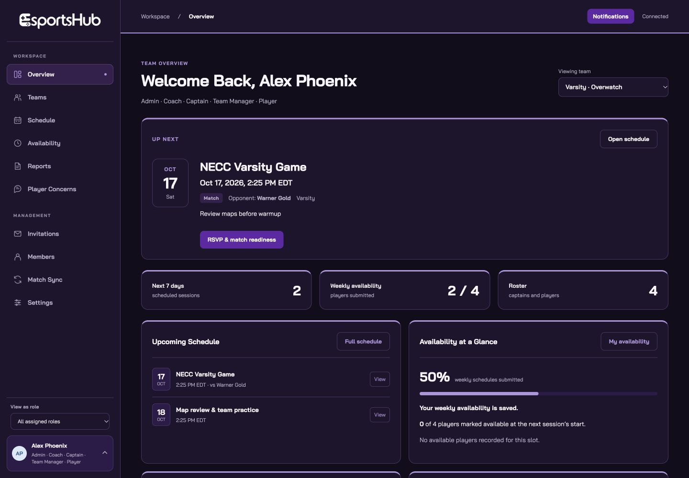
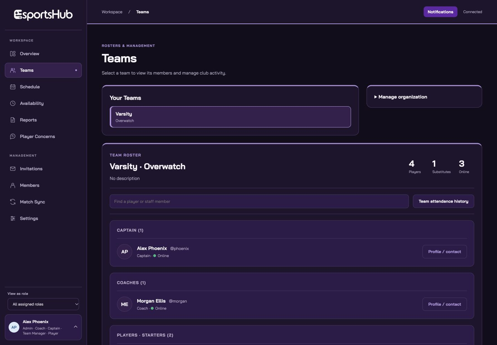
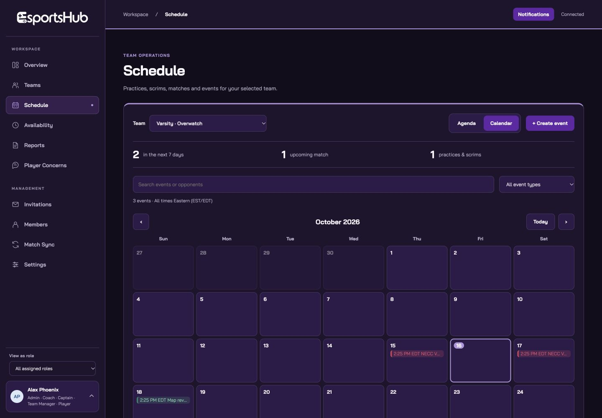
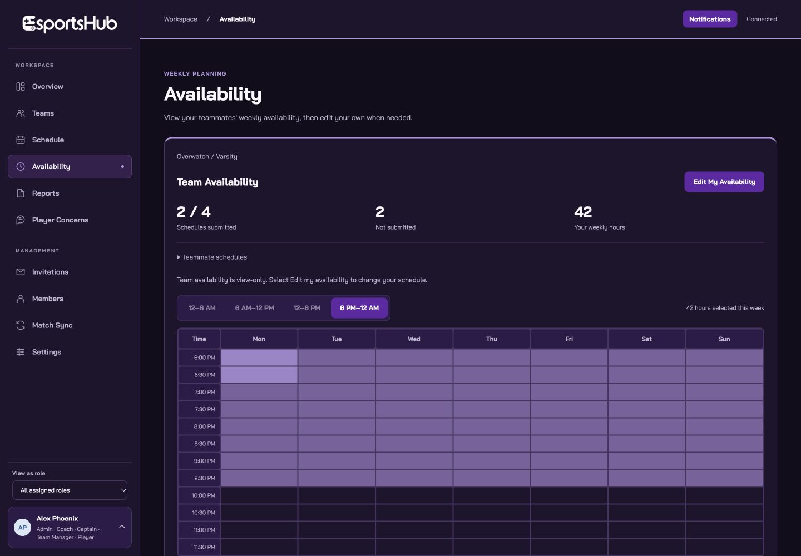
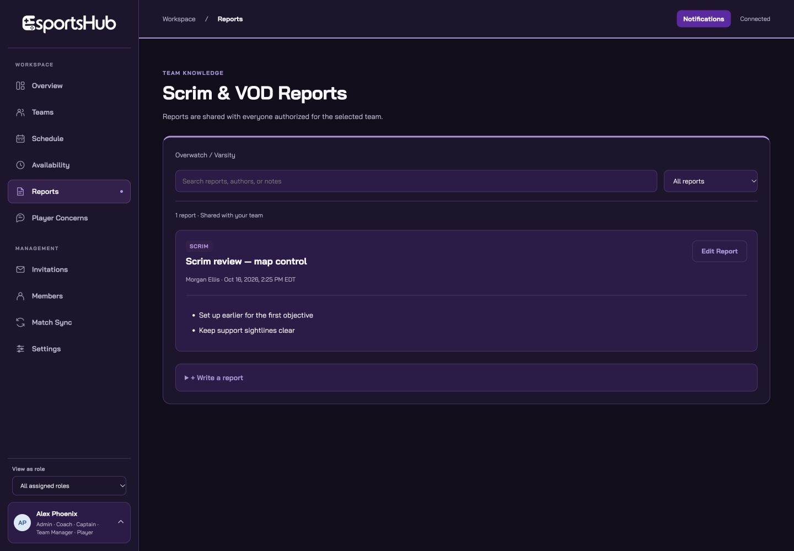

  <picture>
    <source media="(prefers-color-scheme: dark)" srcset="docs/images/esportshub-logo-dark.svg">
    
  </picture>

<strong>A shared workspace for collegiate esports teams.</strong>

  <a href="https://frankrosello.github.io/esportshub/">Open EsportsHub</a> ·
  <a href="#screenshots">Screenshots</a> ·
  <a href="#features">Features</a> ·
  <a href="#user-roles">User Roles</a>

EsportsHub brings rosters, schedules, availability, reports, and team coordination into one place. Originally created for Florida Polytechnic University Esports, it gives players the information they need at a glance while providing staff with tools to manage their teams.

## Screenshots

Screenshots show the local preview with sample accounts and events, not live member data. Features shown may require backend configuration.

### Overview

Upcoming sessions, team availability, results, notes, and contacts in one dashboard.

<strong>Team Rosters</strong>

Separate captain, coach, starter, and substitute sections with profile access and lineup controls for authorized staff.

<strong>Schedule</strong>

Team filters, agenda and calendar views, event details, RSVPs, match preparation, and attendance.

<strong>Availability</strong>

Weekly half-hour availability, teammate coverage, and suggested practice windows in Eastern Time.

<strong>Reports</strong>

Shared scrim notes, VOD reviews, match summaries, and practice reports.

## Features

### Team and Member Management

- Manage multiple games and teams within one organization.
- Organize captains, coaches, starters, and substitutes into clear roster groups.
- Assign roles with team or game scope and support multiple assignments per account.
- Search and filter the member directory; arrange teams by dragging.
- Preview the interface using one of your assigned roles.

### Scheduling and Match Preparation

- Create, edit, and delete practices, scrims, matches, and other events.
- Switch between agenda and calendar views; filter by team or show all accessible teams.
- Collect event RSVPs and choose starters and substitutes for each event.
- Track lineup confirmation, warmup time, and preparation notes.
- Open the NECC match page for captain check-in.
- Sync NECC schedules and results when the required services are configured.
- Display event times in Eastern Time, including daylight saving changes.

### Availability and Attendance

- View teammates’ recurring weekly availability before editing your own.
- Use 30-minute slots with 12-hour time labels and compact time ranges.
- Inspect which players are available, unavailable, or have not submitted a schedule.
- Find practice windows based on shared availability.
- Record present, late, excused, absent, or unrecorded attendance.
- Search attendance lists, mark all players present, and review attendance history.

### Reports and Private Concerns

- Write scrim, VOD, match, and practice reports using a document-style editor.
- Format headings, bold and italic text, lists, quotes, and spacing.
- Add map names and VOD replay codes.
- Attach HTTPS links, images, and videos; file uploads require private R2 storage.
- Let assigned players create reports and edit their own; authorized staff can edit team reports.
- Submit named private concerns for review by authorized game managers and administrators.
- Search the manager concern inbox without exposing submissions to the whole team.

### Profiles and Personal Preferences

- Complete first-time profile setup and customize a display name, pronouns, bio, status, avatar, and banner.
- Choose primary and accent profile colors, avatar decorations, and banner effects.
- Open a mini profile from the account area or a full profile with About Me and Game Accounts tabs.
- Share Discord and in-game usernames, with a Discord username copy control.
- Display activity-based presence with Away, Do Not Disturb, and Invisible preferences.
- Set a default dashboard team and choose name or username for the greeting.
- Cache loaded profiles during the browser session for faster repeat opens.

### Notifications and Responsive UI

- View in-site notifications and reminders while the site is open.
- Refresh notifications on demand, with reduced background polling.
- Use responsive layouts, a full-width mobile navigation menu, and light/dark themes.
- Keep personalized profile styling separate from the solid-color workspace design.

## User Roles

Permissions depend on the account’s assigned team or game scope.

| Role | Main Capabilities |
|---|---|
| **Administrator** | Manage organization-wide games, teams, members, assignments, and private concerns. |
| **Game Manager** | Oversee assigned games and their teams; review private concerns for those games. |
| **Team Manager** | Manage assigned team operations, events, lineups, attendance, and NECC syncing. |
| **Captain** | Coordinate assigned team events, lineups, reports, and attendance. |
| **Coach** | Manage assigned team events, reports, lineups, and attendance. |
| **Player** | View assigned teams, submit availability and RSVPs, write reports, and edit their own reports. |

Captains, coaches, and team managers do not automatically receive access to other players’ private concerns. Unassigned accounts need a team assignment before accessing team tools.

## Technology

| Layer | Technology |
|---|---|
| Frontend | HTML5, CSS3, JavaScript, Bai Jamjuree |
| API | Cloudflare Workers |
| Database | Turso / libSQL |
| Authentication | Clerk |
| Frontend Hosting | GitHub Pages |
| Uploaded Media | Private Cloudflare R2 bucket |
| Match Integration | NECC / LeagueOS calendar feed and configured result syncing |

## Deployment Notes

The frontend and API deploy separately. Hosting the static frontend alone does not configure authentication, the database, or team services.

- Publish the frontend files with their `css/`, `js/`, and `assets/` folders intact.
- Configure the Worker, Turso connection, Clerk keys, and permitted frontend origin separately. Keep secrets out of frontend files and Git history.
- For uploaded images and videos, bind a **private** R2 bucket as `ATTACHMENTS`. Keep public bucket access disabled.
- NECC schedule and result syncing require their corresponding backend configuration. Check-ins remain on NECC.
- Notifications are in-site reminders, not closed-browser push notifications.

## Project Status

EsportsHub is actively developed. The interface and available integrations continue to evolve as team needs change.

## Developer

**Frank Rosello**  
Computer Science Student · Vice President, Florida Poly Esports

[GitHub](https://github.com/frankrosello) · [LinkedIn](https://www.linkedin.com/in/frank-rosello/)

---

EsportsHub is independently developed and is not an official Florida Polytechnic University software product.
