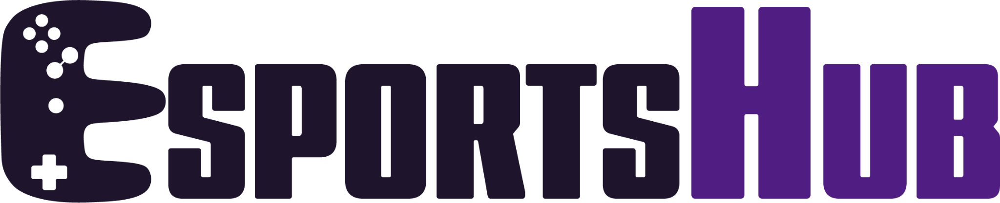
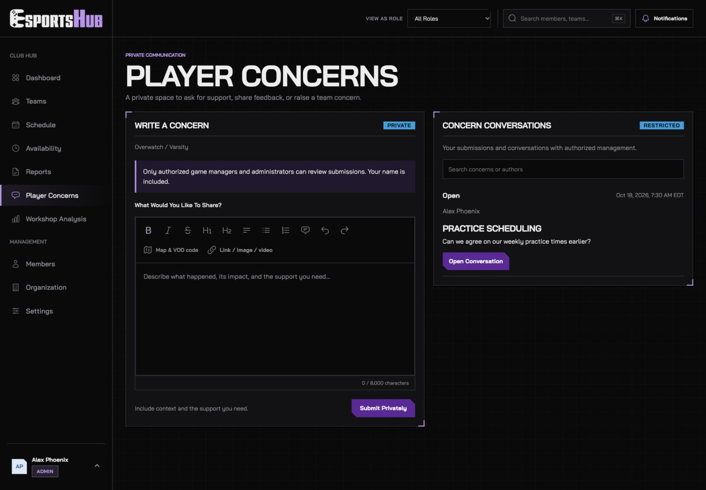
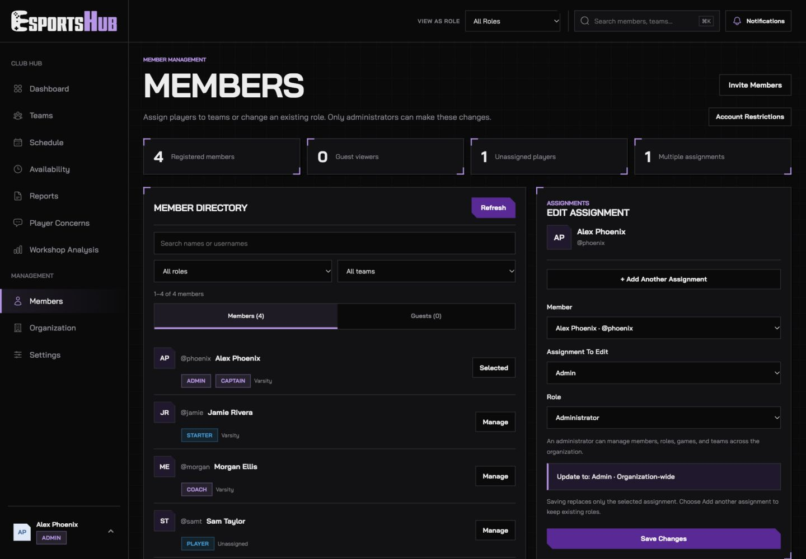
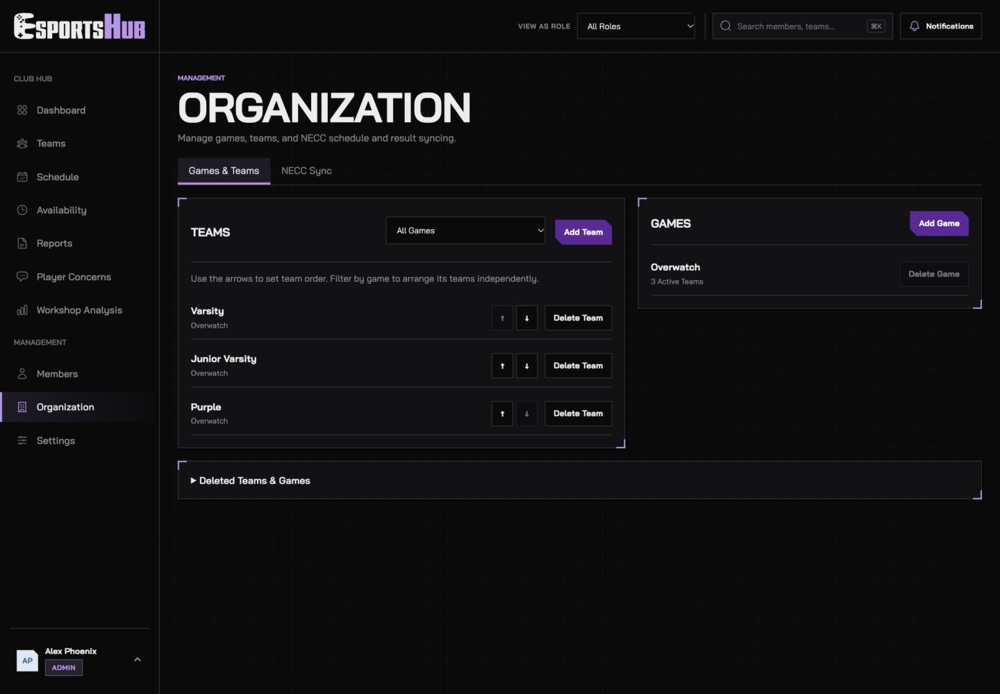
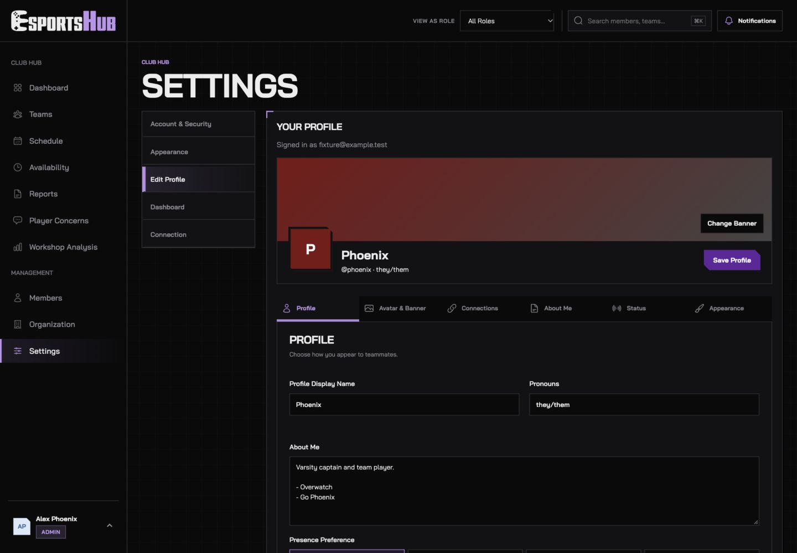

<p align="center">
  <picture>
    <source media="(prefers-color-scheme: dark)" srcset="docs/images/esportshub-wordmark-dark.svg">
    
  </picture>
</p>

<p align="center"><strong>One place for your roster, schedule, and team preparation.</strong></p>

<p align="center">
  <a href="https://frankrosello.github.io/esportshub/">Open EsportsHub</a> ·
  <a href="#screenshots">Screenshots</a> ·
  <a href="#features">Features</a> ·
  <a href="#roles-and-access">Roles & Access</a> ·
  <a href="#deployment">Deployment</a>
</p>

EsportsHub is a web-based management platform for esports teams and organizations. Players can check their next match, respond to events, share availability, and review team notes. Captains, coaches, and managers can coordinate lineups, attendance, resources, and match preparation. Guests get a separate, limited view of the teams they follow.

The interface uses Bai Jamjuree, compact HUD frames, themed controls, and responsive layouts. Cyber combines black surfaces with lavender, purple, and blue; additional light, neutral, and game-inspired presets are available.

## Screenshots

All screenshots below were retaken from the current local preview at **1440 × 1000**, with each page **scrolled completely to the top**. They use fictional accounts and sample events, not live member data. Controls depend on the viewer’s assigned roles and configured backend services.

### Dashboard

The next event, match preparation, season record, attendance, practice hours, and team totals at a glance. Further down are the upcoming schedule, availability, contacts, map pool, notes, news, and recent results.


<details>
<summary><strong>Teams</strong></summary>

Switch teams, search the roster, open profiles, and see captain, coach, starter, and substitute groups. Authorized staff can change the lineup and review attendance. Team resources and the game’s shared map pool follow the roster.


</details>

<details>
<summary><strong>Schedule</strong></summary>

Agenda and calendar views, team and event filters, event creation, RSVPs, lineup readiness, attendance, and NECC match links.


</details>

<details>
<summary><strong>Availability</strong></summary>

A weekly team heatmap, shared personal availability, suggested practice windows, and submission totals. Times use Eastern Time with 12-hour labels.


</details>

<details>
<summary><strong>Reports</strong></summary>

A searchable library for scrim notes, VOD reviews, match summaries, and practice reports, with type and category filters.


</details>

<details>
<summary><strong>Player Concerns</strong></summary>

A formatted writing interface and private conversations with authorized reviewers. Authors can follow replies and the conversation’s status.



</details>

<details>
<summary><strong>Workshop Analysis</strong></summary>

Import an Overwatch Workshop Inspector log by dropping a file or choosing one. Analysis runs locally in the browser.


</details>

<details>
<summary><strong>Members</strong></summary>

A searchable directory, separate member and guest lists, scoped assignments, and an invitation launcher. Administrators can directly assign a player to the substitute lineup.



</details>

<details>
<summary><strong>Organization</strong></summary>

Games and teams, game-filtered Up/Down ordering, creation and deletion controls, recoverable deleted items, and a separate NECC Sync tab.



</details>

<details>
<summary><strong>Profile Settings</strong></summary>

A banner and avatar header, profile tabs, identity fields, presence preferences, and an expandable preview. Existing edits stay in place while switching sections.



</details>

## Features

### Dashboard and Team Updates

- Choose a default dashboard team and switch between accessible teams.
- Show a role-aware dashboard with the information and actions relevant to the active role.
- Feature the next event without repeating it in the upcoming schedule below.
- Open RSVP and match readiness directly from the featured event.
- Review season win/loss record, recorded attendance rate, and scheduled practice hours.
- See the **three most recent completed match results**.
- Read formatted team news, open the full news reader, and publish or edit articles when authorized.
- Review recent reports, team contacts, current map rotation, and relevant follow-up tasks.

### Rosters and Organization

- Group captains, coaches, starters, and substitutes with consistent role labels and profile controls.
- Show usernames first; guest-facing rosters disclose real names only when the player opts in.
- Keep guests out of competitive rosters and separate from members in the directory.
- Support multiple team, game, and organization assignments per account.
- Assign substitutes directly while retaining player permissions; lineup status is separate from administrative access.
- Manage games and teams in Organization, with Up/Down ordering and game-specific filters.
- Confirm team deletion and use the existing deleted-item recovery flow.
- Maintain shared map pools per game, grouped by mode, with images and date-based restrictions. Game managers can edit their assigned game’s pool.

### Events, Availability, and Attendance

- Let assigned players and authorized staff create team events through a popup composer.
- Browse agenda or calendar views, filter event types, and switch between teams or all accessible teams.
- Collect Going, Maybe, or Not Going responses and choose each event’s starters and substitutes.
- Review lineup confirmation, warmup time, and preparation notes. Captains use the NECC match link for check-in.
- Keep event editing, deletion, result management, and attendance controls scoped to authorized users.
- Share one personal weekly availability schedule across all of a player’s teams.
- Open availability in team view; edit personal half-hour slots with draft retention and mobile hold-and-drag selection.
- Show five proportional availability shades, empty slots, and a green state when every starter is available. Hover, focus, or tap a slot to inspect players.
- Suggest practice windows from submitted schedules while identifying missing availability as unknown.
- Track Present, Late, Excused, Absent, and Unrecorded attendance, with separate starter/substitute groups and searchable history.
- Display event times in **Eastern Time (EST/EDT)**, including daylight saving changes.

### Reports and Private Concerns

- Write scrim, VOD, match, and practice reports with headings, emphasis, lists, quotes, links, and spacing controls.
- Organize notes as General, Review, Strategy, Opponent Scouting, or Training.
- Add map names, VOD replay codes, image uploads, and hosted video links.
- Allow assigned players to publish reports and edit their own; authorized staff can manage team reports.
- Submit named private concerns, edit submissions, and exchange formatted replies with authorized reviewers.
- Let authorized game managers and administrators close or reopen concerns. Closed conversations do not accept new replies.

### Profiles, Search, and Notifications

- Guide new accounts through first-time profile setup.
- Customize display name, pronouns, biography, avatar, banner, primary/accent colors, decorations, and profile effects.
- Add an About Me GIF and HTTPS profile connections such as GitHub, LinkedIn, and Battle.net. Connections are links, not verified account integrations.
- Keep drafts across profile tabs and background updates; cache loaded profiles during the current session.
- Open a mini profile from the account control and a full profile from the avatar or View Full Bio.
- Show team role badges and games played based on recorded attendance, rather than claiming unrecorded matches.
- Change Online, Away, Do Not Disturb, or Invisible preferences from the mini profile. Presence uses recent activity, rather than a permanent online flag.
- Search accessible pages, teams, and members with **Command+K on Apple devices** or **Ctrl+K elsewhere**.
- Use the notification popover for unread items, event actions, Mark All as Read, and preferences. Reminders are in-site; they are not closed-browser push notifications.
- Choose Cyber, Black / Dark Grey, White, System, or game-inspired themes. The logo’s Hub color follows the theme highlight.

### Workshop and NECC Tools

- Analyze supported Overwatch Workshop Inspector text logs locally in a Web Worker, with a 20 MB import limit.
- Review map/team information, hero usage, final blows, deaths, eliminations, damage, healing, and ultimates where present in the log.
- Export analysis as JSON or create a report from the summary. Raw logs are not uploaded automatically.
- This is EsportsHub’s basic built-in analyzer, not the hosted Parsertime service or its full skill-rating system.
- Configure NECC / LeagueOS calendar syncing and supported match-result retrieval through the backend.
- Preserve saved results when NECC data cannot be verified or is unavailable. League check-ins remain on NECC.

## Roles and Access

Access is scoped to the account’s assigned teams and games. **View As Role** switches between roles already assigned to the signed-in user; it does not grant new permissions.

| Role | Intended Access |
|---|---|
| **Administrator** | Organization-wide games, teams, member assignments, invitations, and administrative review. |
| **Game Manager** | Assigned games and their teams, shared map pools, and authorized private-concern review. |
| **Team Manager** | Assigned team operations, events, lineups, attendance, reports, and NECC syncing. |
| **Captain** | Assigned team preparation, events, lineups, attendance, and reports. |
| **Coach** | Assigned team events, reports, lineups, attendance, and coaching coordination. |
| **Player** | Assigned team tools, event creation, availability, RSVPs, reports, personal concerns, and permitted guest invitations. Player navigation shows Invite Guests instead of Members. |
| **Guest** | A limited dashboard for assigned teams, with permitted event information, public roster details, and team news. No private team tools or member directory. |

**Substitute** is a player lineup designation. It does not confer staff or administrative permissions. Captains, coaches, and team managers do not automatically receive access to other players’ private concerns.

## Technology

| Layer | Technology |
|---|---|
| Frontend | Static HTML, CSS, and JavaScript |
| Typography and icons | Bai Jamjuree and inline Heroicons outline SVGs |
| Authentication | Clerk |
| API | Cloudflare Workers |
| Database | Turso / libSQL |
| Frontend hosting | GitHub Pages |
| Images | Existing Worker/database upload routes; no separate storage bucket required |
| Workshop processing | Browser Web Worker |
| Match integration | NECC / LeagueOS calendar and configured result syncing |

## Local Development

Serve the frontend from the repository root:

```sh
python3 -m http.server 8000
```

Open `http://localhost:8000/`. Authentication and team data still require a configured Clerk instance, Worker API, and permitted frontend origin. Serving these files alone does not create a demo backend. The sample-data fixture used for screenshots is excluded from the deployment package.

The shipped frontend uses inline icons and needs no runtime icon library. To run the existing dashboard regression tests:

```sh
node --test tests/hud-dashboard.test.cjs
```

## Deployment

1. Publish the frontend with `index.html`, `css/`, `js/`, and `assets/` preserved. Include `js/workshop.js` and all map/logo assets.
2. Configure and deploy the Cloudflare Worker separately, with its database connection, Clerk verification settings, permitted frontend origin, and any required NECC services. The frontend repository/update ZIP does not replace that backend deployment.
3. Keep Worker secrets and database credentials in deployment secrets, outside browser code and Git history.
4. Configure Clerk for the production origin and supported sign-in redirects.
5. Test sign-in, team access, an event response, profile changes, and staff controls using the appropriate roles after deployment.

Image uploads use the existing Worker/database routes with a 4 MB limit. Videos are added by hosted link. No Supabase project or R2 bucket is required by this upload flow. Discord bot integration is not included.

For the current frontend update and validation notes, see [HUD Update Notes](docs/HUD-UPDATE.md).

## Author and License

Built by **Frank Rosello**. [GitHub](https://github.com/frankrosello) · [LinkedIn](https://www.linkedin.com/in/frank-rosello/)

Released under the [MIT License](LICENSE). EsportsHub is independently developed; third-party game and league services remain separate from this project.
